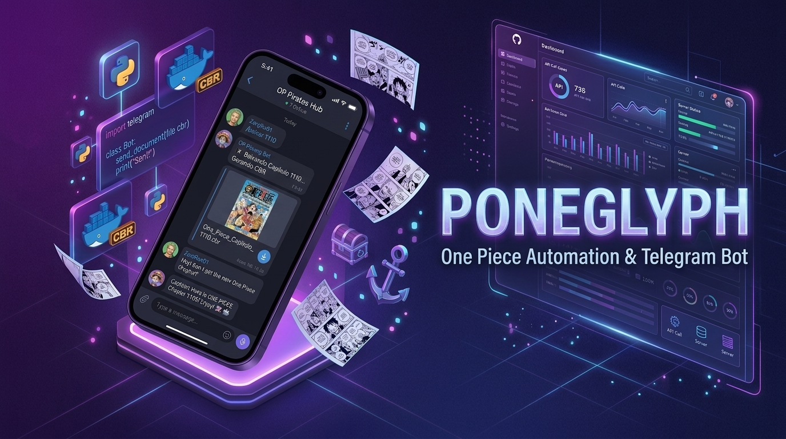

# 🏴‍☠️ Poneglyph - One Piece Automation & Telegram Bot



> **Poneglyph** é uma automação feita em Python que monitora novos capítulos de One Piece, faz o download automatizado das páginas em alta qualidade, gera arquivos de quadrinhos digitais (**CBR**) e envia tudo diretamente no seu chat do Telegram com suporte a comandos interativos.


---

## Principais Funcionalidades

- **Monitoramento Contínuo**: Checa periodicamente se há novos capítulos lançados no site que publica o mangá.
- **Scraper & Downloader Paralelo**: Faz download das páginas em alta resolução preservando a ordem de leitura.
- **Empacotador CBR**: Agrupa as imagens em formato digital de quadrinhos `.cbr` (Comic Book RAR/ZIP) para leitura em apps como Tachiyomi, Mihon, CDisplayEx e Outros.
- **Bot Interativo do Telegram**:
  - `/start` ou `/ajuda`: Exibe guia e comandos.
  - `/baixar <número>`: Faz o download sob demanda de qualquer capítulo e envia para o chat.
  - `/ultimo`: Baixa e entrega o capítulo mais recente registrado.
  - `/check`: Força uma checagem online se há novidades no site.
  - `/estado`: Mostra o último capítulo baixado e timestamp.
- **Mini Servidor HTTP Integrado**: Endpoints para acionar checks, downloads e status via webhooks ou chamadas curl.
- **Pronto para Docker**: Deploy fácil com `docker-compose` e volume persistente para histórico e logs.

---

## 🛠️ Tecnologias Utilizadas

- **Python** (bibliotecas padrão: `urllib`, `threading`, `http.server`, `subprocess`)
- **Telegram Bot API** (envio de documentos, mensagens formatadas e polling de updates)
- **Docker & Docker Compose** (conteinerização e persistência)

---

## 🚀 Como Executar

### 1. Clonar o Repositório
```bash
git clone https://github.com/seu-usuario/poneglyph.git
cd poneglyph
```

### 2. Configurar Variáveis de Ambiente
Copie o modelo de variáveis:
```bash
cp .env.example .env
```
Edite o arquivo [.env](file:///DATA/AppData/poneglyph/.env) com seu token e Chat ID:
```env
TELEGRAM_BOT_TOKEN="123456789:ABCdefGHIjklMNOpqrSTUvwxYZ"
TELEGRAM_CHAT_ID="987654321"
```

### 3. Rodar com Docker Compose (Recomendado)
```bash
docker compose up -d --build
```

Verifique os logs:
```bash
docker compose logs -f
```

### 4. Executar Localmente sem Docker
Certifique-se de ter o `zip` instalado no sistema operacional (para geração do CBR).
```bash
python servidor.py
```

---

## 💬 Comandos do Bot no Telegram

| Comando | Descrição |
|---|---|
| `/start` | Menu inicial com os comandos disponíveis |
| `/baixar 1110` | Baixa o capítulo 1110, empacota em CBR e envia o documento |
| `/ultimo` | Baixa e envia o capítulo mais recente |
| `/check` | Consulta se saiu capítulo novo no site agora |
| `/estado` | Exibe o estado salvo no arquivo local |
| `/cancelar` | Cancela um pedido de download pendente |

---

## 🔒 Segurança e Boas Práticas

- Utilize sempre o .env.example para versionamento no Git.
- O volume `./dados` armazena o histórico (`ultimo_capitulo.json`), offset de mensagens e logs de envio.

---

## 📜 Licença
Distribuído sob a licença MIT. Feito de fã para fãs de One Piece! 🏴‍☠️
